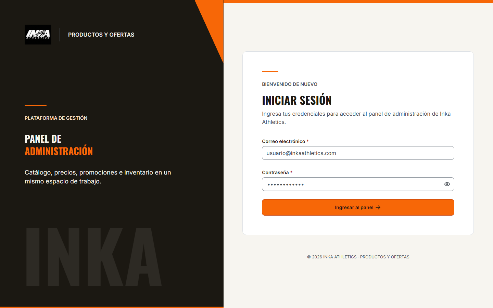
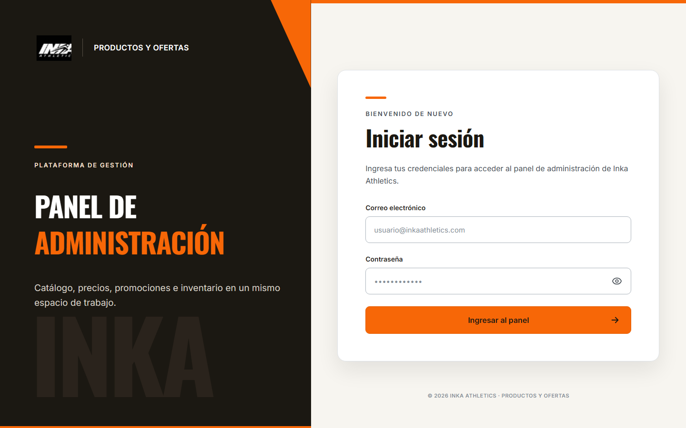
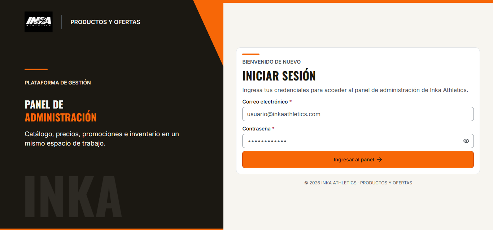
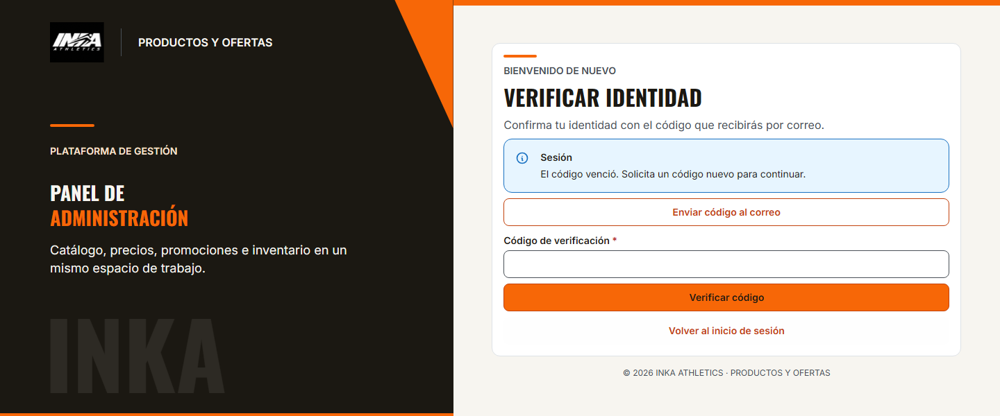

# Login general — implementación y validación

> Seguimiento de auditoría de PR #70: [AUDITORIA_LOGIN_PR70.md](AUDITORIA_LOGIN_PR70.md).
> Los resultados anteriores de este documento son históricos; no sustituyen la
> matriz y las validaciones de la auditoría.
> Segunda revisión sobre `8c5b70e`: [AUDITORIA_LOGIN_PR70_R2.md](AUDITORIA_LOGIN_PR70_R2.md).
> Cuarta auditoría sobre `d247dd6`: [AUDITORIA_LOGIN_PR70_R4.md](AUDITORIA_LOGIN_PR70_R4.md).
> Aceptación externa con MFA real: [procedimiento bilateral](ACEPTACION_BILATERAL_G7_MFA.md).

Fecha de revisión: 06/11/2026. Rama de desarrollo: `poma`. Base comprobada antes
de implementar: `poma = origin/poma = origin/master = 4d1b85969816f2879a6f6f17b3553cccba0ab764`.
El único cambio preexistente era `.gitignore` (exclusión local `MK-LOGIN/`), que se
conserva y se excluye de los commits de esta entrega. No se modifican otros repositorios.

## Fuentes consultadas

- `AGENTS.md`, `README.md`, tarea adjunta y `MK-LOGIN/index.html` local.
- Docs oficial `master` @ `a7778ec1a22811c1213a94ef096ab905911342cc`:
  `ux/mockups/DESIGN.md` 1.1.0 (blob `ae1e41fc787d398ecb5ccbff8d5af46e803320b8`),
  `ux/mockups/ux/ux-guidelines.md`, `ux-decisions.md`, `propuesta-ux.md`, y
  `arquitectura/decisiones/POLITICA-SEGURIDAD-PROGRESIVA-G6.md`.
- Frontend #45; `docs/INTEGRACION_PROMOTIONS_GATEWAY.md`,
  `docs/DEMO_G6_LECTURA_REAL.md`; código y pruebas de la sesión G7 preexistente.
- Política H4 Backend `ops/oracle/H4-MODO-DEMO-AUTH-REVERSIBLE.md` @
  `deb7dbc5b12828f00128f17085e83977dc80ced5`, consultada solo para lectura.
- Provider oficial G7 `Taller-SW-Web/Modulo-de-Seguridad`,
  `specs/contrato-api/openapi.yaml`, `main` @
  `216059de38cd08949c0aca1b9f2ea855ef52aa76`, blob
  `5701435b34396bc4a17384696e34cad536dc4218`. Declara 1.1.0,
  `revision-local-no-publicada`: su lectura no acredita homologación.
  Se cotejaron login, MFA, refresh, logout y los schemas de sesión/desafío.

No hay Docs hermano en este workspace; se consultó mediante GitHub sin copiarlo
al frontend. No se asignan IDs SXX inexistentes: el HTML local representa login;
MFA reutiliza el flujo contractual existente. La referencia implementada es el HTML
local. Se intentó consultar Figma `A2iXA4v3sDJd3Nym0d2Wun`, nodo `139:2`,
pero get_design_context y get_screenshot rechazaron la lectura por el límite
de herramientas del plan Starter. No se declara verificación de Figma.

## Arquitectura y comportamiento

- `AuthSessionContext` expone una sola `G7Session`, creada por la composición de
  `main`. El nombre anterior `PromotionSessionContext` reexporta el mismo contexto.
  La factory de Promotions recibe la misma instancia; no crea una segunda sesión.
- `RequireSession` envuelve `ApplicationShell` y todas las rutas de `productRoutes`,
  incluidos Catálogo/SKU, Taxonomía, Pricing/Auditoría, Promotions/Cupones/
  Recomendaciones, Bulk, Inventario, Combos y rutas desconocidas administrativas.
- `/login` queda fuera del shell. Solo se monta el contenido privado tras obtener
  un token de la sesión; MFA no cuenta como autenticación. La validación ocurre
  al entrar y al vencer el acceso. La navegación de una sesión ya validada conserva
  el shell montado; no se reinicia la validación por cada location.key.
- El retorno admite únicamente rutas administrativas registradas; URLs externas,
  rutas desconocidas, login y demo pública vuelven a `/precios`. No se infieren
  grants. La entrada al panel exige el rol publicado `GESTOR_COMERCIAL`
  (Arquitectura §21); cada operación sigue autorizándose en sus providers.
- El encabezado muestra la identidad recibida y ofrece logout en todos los módulos.
  Logout limpia los tokens y desmonta páginas/hooks privados inmediatamente, incluso
  sin red. Recargar pierde la sesión en memoria. Las respuestas tardías no restauran
  una sesión cerrada; se conservan las garantías de G7Session. El arranque de los
  proveedores administrativos se difiere hasta autenticar. Al terminar o cambiar
  la identidad se recarga el contexto JavaScript para descartar caches y ediciones.
  La persistencia mock y los intentos inciertos de Inventario usan un namespace
  por identidad; la demo anónima mantiene sus claves originales. No se borran
  datos de otra identidad ni sus contratos de sincronización.
- Catálogo administrativo inyecta un transporte autenticado en sus adapters
  existentes. Comparte refresh; reintenta un GET una vez ante `TOKEN_INVALIDO`,
  invalida tras otro 401 y no repite POST/PATCH. Un 401 inicial desconocido o
  ilegible y un 403 conservan la sesión y el error.
  Taxonomía, Bulk y Promotions conservan sus mecanismos y usan la misma instancia.
- No se altera el transporte de `/demo/g6/*`: lectura aislada bajo sus flags
  existentes, sin acceso indirecto al árbol administrativo.
- `DEV` + modo global `mock` permite probar fixtures sin fabricar una identidad.
  En modo `api` y en todos los builds de producción se exige sesión. Ningún error
  de G7/Gateway activa un fallback. No se implementa el selector documental
  `G6_SECURITY_MODE` ni se amplían excepciones públicas.
- Se elimina el formulario incrustado `PromotionSessionGate`. Login/MFA usan
  `LoginForm`; las capacidades de sesión siguen en la clase G7 existente.
- No se guardan tokens, desafíos ni contraseñas en almacenamiento persistente,
  URLs o logs. No hay credenciales técnicas, registro ni recuperación de contraseña.

## Pantalla y diferencias normativas frente al HTML

Se conserva el logo original existente, dos paneles con proporción 45.3125/54.6875,
panel ink, marfil, tarjeta blanca, franjas y acción naranja. Se reutilizan Mantine,
Inter/Oswald locales, Tabler, el theme y FeedbackAlert. Sin nuevas dependencias.

| Elemento de MK-LOGIN | Regla DESIGN | Corrección en React |
| --- | --- | --- |
| Foco naranja | §4.1/4.4, focus/default | Azul `#4361EE`, 2 px/offset 2 |
| H1 47 px, H2 de marca ~59 px, tracking local | §4.2 | H1 32/40, H2 28/36, Oswald/mayúsculas, tracking 0 |
| Inputs 56 px, botón 58 px | §6, tamaños de controles | Inputs md 40 px y botón lg 48 px |
| Bordes #ADB5BD y hover local | §4.1 | border/control y secondary del theme |
| Hover naranja claro del botón | §4.1 | primary-hover oscuro con texto inverse |
| Radios 9/18 px y sombra de tarjeta | §4.4/4.5 | Controles 8 px, card 12 px, sin elevación |
| Tonos decorativos y pie gris disabled | §4.1 | Tokens existentes; pie secundario legible |
| Gaps arbitrarios | §4.3 | Combinaciones de 4/8/16/24/32 px |

Estas diferencias se aplican solo al frontend; no se edita el HTML ni DESIGN.
Owners de cualquier cambio normativo futuro: responsable de DESIGN/UX y owner
frontend; no se propone un segundo sistema visual desde este repositorio.

Capturas comparables 1440 × 900:

## Validación

- `npm run typecheck`: PASS.
- `npm run lint`: PASS.
- `npm test`: PASS, 462 pruebas unitarias, incluidas 24 nuevas de sesión compartida,
  configuración, retorno seguro y transporte administrativo de Catálogo.
- `VITE_DATA_MODE=api npm run build`: PASS.
- `VITE_DATA_MODE=mock npm run build`: PASS.
- `VITE_DATA_MODE=mock`, `PLAYWRIGHT_PORT=5185`,
  `npm run test:e2e -- --workers=4 --reporter=line`: **FAIL**, 568 PASS,
  3 FAIL y 6 SKIP en 14,1 minutos. Los casos del login/sesión general pasaron.
- `VITE_DATA_MODE=mock`, `PLAYWRIGHT_PORT=5187`,
  `npm run test:e2e -- --last-failed --workers=1 --reporter=line`: **PASS**,
  los tres casos fallidos pasaron en serie en 39,5 segundos. Fueron Inventario
  (`inventory.spec.ts:406`), Auditoría (`price-audit.spec.ts:561`) y Bulk transversal
  (`transversal-integration.spec.ts:111`). No se modificó su lógica de negocio ni
  se aumentaron timeouts para obtener ese resultado. La inestabilidad con cuatro
  workers queda registrada; no se declara que fuera preexistente ni que la suite
  completa paralela haya pasado.
- Comprobación final focalizada: PASS, 37 pruebas de login/configuración y harnesses de Catálogo (`PLAYWRIGHT_PORT=5186`, dos workers).
- `node scripts/verify-production.mjs api http://127.0.0.1:5184`: PASS, 59 entradas protegidas.
- `node scripts/verify-production.mjs mock http://127.0.0.1:5184`: PASS, 59 entradas protegidas (incluidos dos harnesses inaccesibles en producción) a 1440 px.
- `node scripts/vercel-smoke.mjs http://127.0.0.1:5184`: PASS, cinco entradas + recarga, 23 recursos JS/CSS.
- Visual: comparación de ambas capturas, sin overflow horizontal; labels, ojo,
  requeridos, teclado y foco comprobados por navegador. MFA incluye foco al código
  después de finalizar el envío, errores inválido/vencido y desafío terminado.

Precondiciones: Node disponible `24.16.0`, npm `11.13.0`, Chromium instalado. El
repositorio declara Node 22; no se afirma haber ejecutado localmente con Node 22.
Los comandos completos PowerShell están en README. Se usó puerto Playwright 5185
para no reutilizar el Vite preexistente en 5173 (modo API). El primer intento de la
suite completa sobre ese servidor se interrumpió y no se considera una validación.
Los harnesses de adapters ahora usan `FeatureTestApp`, exclusivo DEV, para probar
features sin fabricar una identidad G7. Las pruebas de autenticación usan `App`
real y su guard; no se introduce ningún bypass de pruebas en código productivo.

## Integración y pendientes

Estado: UI_COMPLETE; sesión y transporte comprobados con providers contractuales
locales/fixtures, sin acreditar G7 compartido. `MOCK_ONLY` describe los providers de
prueba; no existe login exitoso simulado en el código productivo.

- Pendiente G7/Gateway: URL operativa autorizada, CORS, issuer/JWKS, identidades y
  grants efectivos, y prueba bilateral con credenciales genuinas. Owners G7 y
  coordinación G6/#45. No se hicieron llamadas al G7 compartido ni escrituras
  comerciales reales para esta entrega.
- Runner Backend Gateway/PG/TLS: NO EJECUTADO aquí; sus pruebas E2E condicionadas
  se reportan como omitidas, nunca PASS. Backend no se modifica ni se inicia.
- Pricing, Inventario, Combos y otros providers pendientes mantienen sus límites
  actuales: autenticar la plataforma no completa esas integraciones.
- Los scripts de preview pasan a comprobar el límite de acceso de producción;
  `npm run test:production:auth` comprueba además el panel compilado con G7/Gateway
  contractuales aislados. No acreditan homologación ni despliegue.
- Revisión UX y técnica por el equipo, permisos efectivos e integración compartida
  siguen separados. No se fusiona ni se despliega este cambio.

## Inventario de archivos de la entrega

| Archivo | Motivo |
| --- | --- |
| `.env.example` | Documentar la sesión general y sus bases sin secretos. |
| `README.md` | Ejecución local, política DEV/producción y comandos reales. |
| `docs/INTEGRACION_PROMOTIONS_GATEWAY.md` | Registrar la migración sin reescribir evidencia histórica. |
| `docs/LOGIN_GENERAL.md` | Fuentes, arquitectura, validación, inventario y límites. |
| `docs/evidencias/login-general-1440.png` | Captura React a 1440 × 900. |
| `docs/evidencias/login-referencia-1440.png` | Captura comparativa del HTML local. |
| `playwright.config.ts` | Puerto aislado opcional y evitar reutilizar el servidor incorrecto. |
| `scripts/vercel-smoke.mjs` | Comprobar login/recarga y recursos compilados anónimos. |
| `scripts/verify-production.mjs` | Verificar el guard compilado en mock/API en 59 entradas. |
| `src/app/config/AuthSessionContext.ts` | Contexto transversal de la instancia G7. |
| `src/app/config/CommercialModeGate.tsx` | Conservar límites de providers y retirar el login incrustado. |
| `src/app/config/PromotionSessionContext.ts` | Alias compatible del mismo contexto, sin duplicar estado. |
| `src/app/config/authSessionRuntime.ts` | Crear G7Session o fallar cerrado ante configuración inválida. |
| `src/app/config/useAuthSession.ts` | Suscripción compartida y estado indisponible estable. |
| `src/app/layout/ApplicationShell.tsx` | Identidad recibida y cierre de sesión en el encabezado. |
| `src/app/routes/AppRoutes.tsx` | Login público independiente y árbol administrativo protegido. |
| `src/app/routes/RequireSession.tsx` | Validación previa, navegación y expiración; excepción DEV mock. |
| `src/app/routes/loginDestination.ts` | Retorno limitado a rutas internas registradas. |
| `src/features/auth/auth.test.ts` | 24 casos unitarios de sesión única, retorno y transporte. |
| `src/features/auth/components/LoginForm.tsx` | Credenciales, validación, ojo, carga y MFA accesibles. |
| `src/features/auth/pages/LoginPage.tsx` | Composición independiente del shell y redirección de sesión. |
| `src/features/auth/pages/login.module.css` | Composición del HTML con tokens visuales normativos. |
| `src/features/catalog/adapters/authenticatedCatalogTransport.ts` | JWT compartido, refresh de lecturas y no repetir escrituras. |
| `src/features/promotions/adapters/g7Session.ts` | Exponer deadline de acceso y mensaje contractual OTP_EXPIRADO. |
| `src/features/promotions/components/PromotionSessionGate.tsx` | Eliminar el segundo formulario de login ya sustituido. |
| `src/features/promotions/services/promotionSessionRuntime.ts` | Aceptar la instancia compartida conservando la factory existente. |
| `src/features/taxonomy/services/taxonomyGatewayRuntime.ts` | Retirar la indicación obsoleta de iniciar sesión en Promociones. |
| `src/main.tsx` | Crear la sesión única e inyectarla en los providers existentes. |
| `src/theme/component-defaults.ts` | PasswordInput usa tipografía y placeholder normativos. |
| `src/theme/primitives.module.css` | Estilo del input interior de contraseña con tokens existentes. |
| `tests/auth-general.spec.ts` | E2E de App real contra provider G7 loopback, rutas, MFA, expiración, logout y captura. |
| `tests/bulk-http.spec.ts` | CORS del provider aislado admite el puerto de Playwright seleccionado. |
| `tests/harness/FeatureTestApp.tsx` | Composición DEV aislada para pruebas de features, sin usuario G7 ficticio. |
| `tests/harness/audit-adapter.tsx` | Usar FeatureTestApp para conservar pruebas de adapters sin atravesar el login. |
| `tests/harness/catalog-adapter.tsx` | Usar FeatureTestApp para conservar pruebas de adapters sin atravesar el login. |
| `tests/harness/catalog-http.tsx` | Usar FeatureTestApp para conservar pruebas de adapters sin atravesar el login. |
| `tests/harness/inventory-adapter.tsx` | Usar FeatureTestApp para conservar pruebas de adapters sin atravesar el login. |
| `tests/harness/inventory-http.tsx` | Usar FeatureTestApp para conservar pruebas de adapters sin atravesar el login. |
| `tests/harness/pricing-adapter.tsx` | Usar FeatureTestApp para conservar pruebas de adapters sin atravesar el login. |
| `tests/harness/pricing-review.tsx` | Usar FeatureTestApp para conservar pruebas de adapters sin atravesar el login. |
| `tests/promotions-session-gateway.spec.ts` | Actualizar selectores al formulario general del runner externo. |
| `tests/promotions-session-ui.spec.ts` | Usar formulario general, selectores accesibles y ausencia de segundo login. |
| `tests/promotions-startup.spec.ts` | Esperar bloqueo general API y formulario deshabilitado sin G7. |
| `tests/promotions-visual.spec.ts` | Comprobar redirección general sin montajes privados ni mocks API. |
| `vitest.config.ts` | Incluir los tests unitarios de autenticación en npm test. |

## Matriz de cierre comprobado

- [x] Fuentes normativas y referencias identificadas; Figma limitado por cuota.
- [x] Alcance y pantalla local identificados sin inventar SXX.
- [x] Git inicial inspeccionado y `.gitignore` previo preservado fuera del commit.
- [x] Typecheck, ambos builds y lint ejecutados con resultado PASS.
- [x] Unitarias: 462 PASS. E2E: resultado completo y repetición serial registrados arriba.
- [x] Capturas y revisión desktop 1440 × 900, teclado, foco y ojo verificados.
- [x] Formulario vacío/requeridos, errores, MFA, expiración, recarga y logout verificados.
- [x] Los componentes visuales no realizan HTTP directo.
- [x] No hay HEX locales nuevos ni familias cromáticas nuevas en la UI.
- [x] No se inventaron contratos, scopes, roles productivos ni estados de backend.
- [x] Docs/Backend/Supabase/despliegues no modificados.
- [x] Limitaciones externas, Node 24 local e inestabilidad E2E paralela registradas.
- [x] Estado: UI_COMPLETE, pruebas contractuales aisladas; G7 compartido pendiente.

No se marca VALIDATED ni homologación. Las seis omisiones corresponden a pruebas
que exigen runners externos; no son seis PASS. El PR se entrega para revisión,
sin merge ni despliegue. La estabilidad de los tres casos con cuatro workers y
la CI remota permanecen pendientes; la repetición serial no sustituye esa evidencia.

## Corrección de ajuste y navegación — 06/11/2026

Alcance solicitado: conservar el frontend existente, limitando los cambios al
login, la identidad de sesión y el cierre de sesión. Comparado con `4d1b859`, las
páginas de los módulos, el menú y `productRoutes.tsx` no tienen diferencias. El
shell conserva su diseño; la adición anterior es la identidad y el botón logout.
Esta corrección no modifica páginas, servicios, reglas, contratos ni datos de
los módulos, ni cambia la política MFA de G7.

Se reprodujeron tres regresiones con pruebas nuevas sobre `674091f`: el shell
perdía sus nodos al navegar, el login excedía la altura de ventanas bajas y MFA
podía necesitar desplazamiento. Las tres pruebas fallaron antes de la corrección.

- Se elimina el mínimo fijo de 780 px de los paneles del login. Su espaciado se
  adapta a la altura disponible manteniendo los dos paneles desktop, tipografía,
  colores y controles. No se ocultan el scroll ni los campos mediante clipping.
- En MFA, las instrucciones sustituyen la descripción de credenciales, evitando
  repetir texto y consumir altura adicional.
- El guard vincula su validación a la instancia de sesión y al usuario, en lugar
  de `location.key`. Conserva el shell al navegar, pero mantiene el bloqueo inicial,
  la expiración, la invalidación y el logout.
- La prueba de navegación marca los nodos reales de encabezado y menú y comprueba
  que sean los mismos tras seis cambios de sección. No se modifican las transiciones
  ni los estados de carga de las páginas existentes.

Las pruebas visuales cubren login vacío/error a 1440×900, 1366×768, 1440×720,
1366×640 y 1440×600; MFA/código vencido a 1440×900/720/640/600. Se comprueba
altura/ancho de documento sin overflow, botón y pie dentro del viewport, y se
inspeccionan las capturas. En zoom elevado o ventanas aún menores se conserva el
flujo natural accesible; no se esconden controles para simular que caben.

Capturas de revisión:

Validaciones ejecutadas para esta corrección:

- `npm run typecheck`: PASS.
- `npm run lint`: PASS.
- `npm test`: PASS, 462 pruebas unitarias.
- `VITE_DATA_MODE=api npm run build`: PASS.
- `VITE_DATA_MODE=mock`, `PLAYWRIGHT_PORT=5188`,
  `npm run test:e2e -- tests/auth-general.spec.ts tests/promotions-session.spec.ts tests/promotions-session-ui.spec.ts tests/promotions-startup.spec.ts tests/foundation.spec.ts --workers=1 --reporter=line`:
  PASS, 53 pruebas en 2,0 minutos.
- Las tres regresiones nuevas fallaron antes de la corrección y pasaron después.
  Las 53 incluyen bloqueo sin sesión, MFA, refresh/401/403, expiración, logout,
  ausencia de persistencia, demo pública, teclado y geometría Foundation.
- Revisión visual de login a 1366×640 y MFA con error a 1440×600: PASS, sin scroll,
  controles recortados ni superpuestos. Se conserva la revisión canónica 1440×900.
- `git diff 4d1b859 --` aplicado a los directorios de páginas de módulos, navegación
  y `productRoutes.tsx`: sin diferencias.

La suite completa de 577 pruebas no se reejecutó en esta corrección: sus resultados
anteriores quedan como evidencia histórica en la sección Validación, con sus
fallos y omisiones explícitos. Tampoco se afirma integración real G7/Gateway ni
validación Figma nueva.

Archivos de código de esta corrección: `src/app/routes/RequireSession.tsx`,
`src/features/auth/components/LoginForm.tsx`, `src/features/auth/pages/LoginPage.tsx`
y `src/features/auth/pages/login.module.css`. Se actualizan las pruebas de
`tests/auth-general.spec.ts`, README, este informe y tres capturas del login/MFA.
Estado de esta corrección: UI_COMPLETE; solo ámbito de autenticación.
